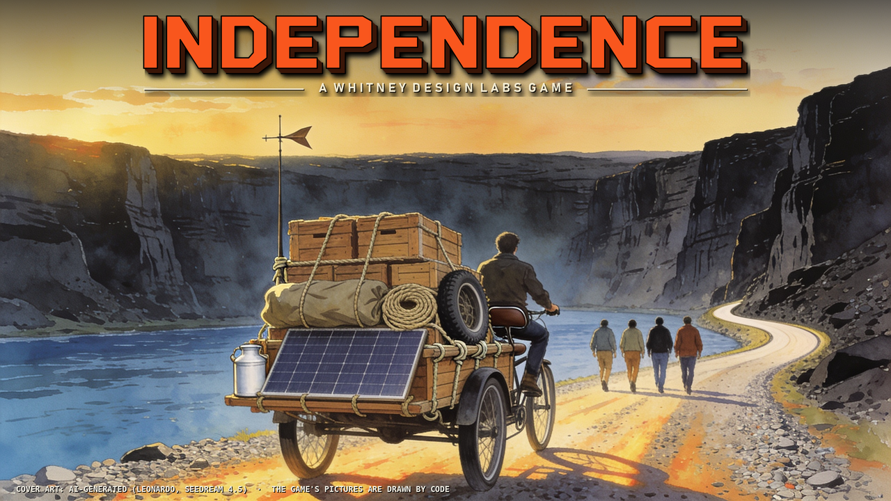

**Watch the trailer** (3 min): https://youtu.be/vJguUZ5YdAY

# INDEPENDENCE 1.0

**A WHITNEY DESIGN LABS GAME, FOR THE APPLE IIE.**

Oregon City, 2031. Two years after the Red Meteor, with no fuel and no grid, the lights came back on in Independence,
Missouri, and a voice on the ham radio says come east. The co-op at the Hall is sending a party with the freight, and
the party is yours. Pick a trade, name your four, build a rig out of what the town can spare, and get the parcels to the
people waiting for them.

INDEPENDENCE is a trail game and a text adventure with pictures for a forty-year-old computer. This first release is
Act 1, the road from Oregon City to The Dalles: two disk sides, two ways up the gorge, six trades, a radio that answers,
and a wall in The Dalles where every party that makes it signs its name. The trail continues east in free updates.
Nobody dies in this game.

## Credits

Design, writing and hardware: Scott Whitney. Code, tools and pattern art written with Claude (Anthropic). Story seed: a
lunch with Jimmy. One-disk HOME.BASE edition: Jonathan Adar. CoGS card: Rob Perissi. Cover art: AI-generated, labelled.
A tip of the hat to Don Rawitsch, Bill Heinemann and Paul Dillenberger, 1971.

## Download

The zip `INDEP1.zip` holds both disk sides, a disk that tests your network card (`NETCHECK.dsk`), the serial relay for a
PC (`net/`), a README, a note from the author and the licence. Each disk image is also offered on its own. It is free.

With a CoGS card the game also plays straight from the network, both sides on one volume and no disk change: mount
`http://158.101.9.238/DISKS/INDEP1.PO` as the card's drive 1 and boot slot 7. That copy is shared, so it is read-only;
to keep a saved game, copy the image to your own machine (the card's Image Manager share takes writes) or play from the
floppies.

Or play it in your browser, nothing to install: https://whitneydesignlabs.github.io/independence/

## Four ways to play

1. **On an Apple IIe, from floppies or a Floppy Emu.** `INDEP-A.dsk` in drive 1, `INDEP-B.dsk` in drive 2 (or one drive:
   the game asks for side B when the party leaves town). Write them to 5.25-inch disks with ADTPro, or put the images on
   a Floppy Emu in 5.25-inch mode.
2. **On a CoGS card, straight from the network.** In the card's menu mount `http://158.101.9.238/DISKS/INDEP1.PO` as
   drive 1 (type `http://` in lower case) and boot slot 7 (`PR#7`): both sides on one volume, no disk change, the net
   live. The shared copy is read-only; to keep a saved game, copy the image to your own machine.
3. **In an emulator.** AppleWin (1.32): the two `.dsk` images in drives 1 and 2, an Apple //e with 128K. Its Super
   Serial Card with the relay, or its Uthernet II, puts it online (README.txt, THE NET).
4. **In your browser.** https://whitneydesignlabs.github.io/independence/ - this repository's `docs/`, Apple2TS with both sides in the drives and
   the net over a secure WebSocket.

## What you need

- An Apple IIe (unenhanced or enhanced), IIc, IIc Plus, IIgs or Platinum IIe **with 128K** (an extended 80-column card
  in a IIe), and one 5.25-inch drive; a second is welcome. Or an emulator of one, such as AppleWin.
- A Mockingboard in slot 4 or 5 is optional; without one every sound plays on the speaker. A Mockingboard with a speech
  chip (an SSI-263: the Mockingboard C, the Sound/Speech I) talks: tested on AppleWin 1.32; on a real Mockingboard with
  an SSI-263, expected but unverified.
- ProDOS 2.4.1 is on the disks. Nothing has to be installed. Side A keeps your one saved game: keep it writable.

## The net

The game plays whole without a network. With a CoGS card (Rob Perissi's network coprocessor card, a2cogs.com: Wi-Fi
or Ethernet, nothing to set), a Super Serial Card (and a PC running the relay) or an Uthernet II, it talks to the game's
server: the departures board in the Hall counts the parties that have set out, the Register in The
Dalles shows the parties that signed it, newest first, and the notes you write in a logbook are there for the next
party to read. Some things in the game are real, and online it can show you where to read about them. `NETCHECK.dsk`
tests the card and sets an Uthernet II's addresses. The game looks for a CoGS card first, then a serial card, then an
Uthernet II; the CoGS card was tested with its firmware 1.38 in slot 7 of an enhanced IIe. The server is `158.101.9.238`, port `6502`. The CoGS card needs nothing typed;
an Uthernet II takes it in `NET SETUP`; the serial relay takes it on its command line (the README has both).

The server and the card drivers are open source, for anyone who wants to put their own 6502 program on the same
wire: https://github.com/WhitneyDesignLabs/trail-net

## How this release plays

- **Every way out of a room is in its picture**: a door, an opening, the road going on, or behind you the daylight of
  the door you came in by.
- **A save that stumbles tries again.** If the last step of a SAVE fails (a worn floppy, a card that drops a block),
  SAVE tries it again before it gives up; if it still cannot, it says SAVE FAILED and your last good save stays as it
  was.
- **The pager never scrolls a page away**: a page that needs more room waits at `[MORE]` for a key.

## Six trades

Okafor at the Hall asks what you did before. Five of the answers are the trades you would expect on a road like this one.
The sixth is a salesman's, and it plays a little differently: the town notices, and the Register remembers how you came
through. Try it after your first crossing.

## Fact and fiction

**INDEPENDENCE is a fiction.** The year 2031, the Red Meteor and the second eruption of Mount St. Helens did not happen;
the people are invented. **The places are real**, and so are some things in the game: Walt's jars of ash from the 1980
eruption, the trike, the cart, the shanty boat Dustyfoot, the amateur radio call on the fourth card in the shack, the
hop yards of the Willamette Valley. Where the game touches something real it says so, and online it can link to it.

**How it was made:** designed and directed by Scott Whitney; written, programmed and drawn with Claude (Anthropic's AI)
working to his design and decisions. The pictures are drawn by a program from lists of lines and fills, in the Apple's
six colours; none is a photograph, a scan or an AI image generator's picture. [SCOTT: confirm this wording, and the
labelling of the cover art and the page's screenshots before publishing.]

## Thanks

With thanks to Don Rawitsch, Bill Heinemann and Paul Dillenberger (1971) and MECC (1985), whose trail we all walked in
school. **Theme suggested by Jimmy**, who also gave us the sixth trade over lunch.

## Stuck?

If the game stops, says something that cannot be right, or leaves you somewhere with no way on, please
[open an issue](https://github.com/WhitneyDesignLabs/independence/issues) with the last few things you typed and which
side was in the drive.

## The files

The checksums (sha256) are in `CHECKSUMS.txt` in the zip, and here:

| File | sha256 |
|---|---|
| `INDEP-A.dsk` | [from the build that is released] |
| `INDEP-B.dsk` | |
| `NETCHECK.dsk` | |
| `net/ssc_relay.exe` | |
| `net/ssc_relay.py` | |
| `README.txt` | |
| `README-FROM-SCOTT.txt` | |
| `LICENSE.txt` | |

## Licence

INDEPENDENCE is free to download and play. The terms are in `LICENSE.txt`.

**A WHITNEY DESIGN LABS GAME**
